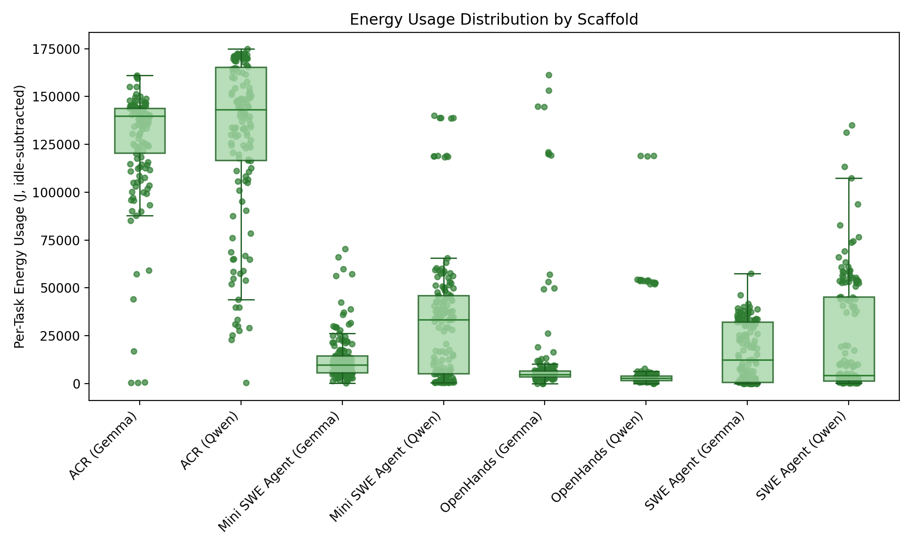

<div align="center">

# SWEnergy: An Empirical Study on Energy Efficiency in Agentic Issue Resolution Frameworks with SLMs

**Replication Package**

[](https://arxiv.org/abs/2512.09543)
[](https://dl.acm.org/doi/10.1145/3786167.3788406)
[](https://dl.acm.org/doi/pdf/10.1145/3786167.3788406)
[](https://dl.acm.org/doi/proceedings/10.1145/3786167)
[](https://creativecommons.org/licenses/by/4.0/)
[](https://www.swebench.com/)
[](https://www.python.org/)

**Arihant Tripathy · Ch Pavan Harshit · Karthik Vaidhyanathan**

Software Engineering Research Center, IIIT Hyderabad, India

</div>

---

This repository is the replication package for the paper *SWEnergy: An Empirical Study on Energy Efficiency in Agentic Issue Resolution Frameworks with SLMs*, published in the Proceedings of the 2026 International Workshop on Agentic Engineering (AGENT '26), co-located with ICSE 2026 in Rio de Janeiro, Brazil. It contains the instrumented harnesses used to run each framework, the raw per-issue measurements and agent trajectories, the SWE-bench evaluation reports, and the analysis scripts that produce every table and figure in the paper.

## Abstract

LLM-based autonomous agents in software engineering rely on large, proprietary models, which limits local deployment. Small Language Models (SLMs) are an attractive alternative, but their practical effectiveness and efficiency inside complex agentic frameworks for automated issue resolution are poorly understood. We run a controlled evaluation of four agentic frameworks (**SWE-Agent**, **OpenHands**, **Mini SWE Agent**, **AutoCodeRover**) with two SLMs (**Gemma-3 4B**, **Qwen-3 1.7B**) on **SWE-bench Verified Mini**, measuring energy, duration, token usage and memory over 150 runs per configuration on fixed hardware. Framework architecture is the primary driver of energy consumption: AutoCodeRover (Gemma) used 9.4× more energy on average than OpenHands (Gemma). Most of that energy is wasted, since resolution rates were near zero (4% for AutoCodeRover, 0% for all others). The SLM's limited reasoning was the bottleneck for success, and the framework's design was the bottleneck for efficiency.

## Key Results

Means over 3 repetitions × 50 issues per configuration (Table 1 of the paper). Energy is CPU (RAPL) + GPU (NVML).

| Framework | Model | Total energy / issue (kJ) | Time / issue (min) | Tokens / issue | Cost / issue (USD) | Resolved (of 50) |
|---|---|---:|---:|---:|---:|:---:|
| AutoCodeRover | Gemma-3 4B | 216.21 | 27.08 | 405k | 0.0081 | 0 |
| AutoCodeRover | Qwen-3 1.7B | 208.42 | 23.79 | 460k | 0.1245 | **2 (4%)** |
| SWE-Agent | Gemma-3 4B | 34.78 | 5.59 | 789k | 0.0311 | 0 |
| SWE-Agent | Qwen-3 1.7B | 44.87 | 9.02 | 1,250k | 0.1428 | 0 |
| Mini SWE Agent | Gemma-3 4B | 23.41 | 3.20 | 548k | 0.0220 | 0 |
| Mini SWE Agent | Qwen-3 1.7B | 54.13 | 8.54 | 1,874k | 0.2178 | 0 |
| OpenHands | Gemma-3 4B | 23.05 | 4.13 | 106k | 0.0043 | 0 |
| OpenHands | Qwen-3 1.7B | 23.33 | 6.89 | 110k | 0.0131 | 0 |

- **Architecture drives energy.** AutoCodeRover (Gemma) used **9.4×** the energy of OpenHands (Gemma).
- **That energy is mostly wasted.** Only AutoCodeRover (Qwen) resolved any issues; every other configuration resolved none.
- **Energy tracks runtime and output tokens** (R = 0.89 and R = 0.88), while memory shows near-zero correlation.

Full statistics (mean, min, median, max, std) are in [`tables_all.csv`](tables_all.csv), per-run summaries in [`run_summary_all.csv`](run_summary_all.csv), and per-issue records in [`per_issue.csv`](per_issue.csv).

<p align="center">
  
</p>

## Repository Structure

```
.
├── openhands_main.py              # Instrumented harness: OpenHands
├── swe_agent_main.py              # Instrumented harness: SWE-Agent
├── mini_swe_agent_main.py         # Instrumented harness: Mini SWE Agent
├── autocoderover_main.py          # Instrumented harness: AutoCodeRover
├── mini_swe_agent_get_datasets.py # Maps SWE-bench Verified Mini IDs to Verified indices
│
├── acr_{gemma,qwen}/              # Raw results: AutoCodeRover (JSONL + per-issue artifacts)
├── swe_agent_{gemma,qwen}/        # Raw results: SWE-Agent (JSONL + trajectories)
├── mini_swe_agent_{gemma,qwen}/   # Raw results: Mini SWE Agent (JSONL + trajectories)
├── openhands_{gemma,qwen}/        # Raw results: OpenHands (JSONL + logs)
├── sb-cli-reports/                # SWE-bench evaluation reports (sb-cli), one per run
├── gemini_analyses/               # LLM-assisted failure analysis of every trajectory
│
├── scripts/                       # Aggregation, statistics and plotting
│   ├── analyze_results.py         #   Summary tables, per-issue CSV, idle adjustment
│   ├── contribution_analysis.py   #   Correlations: calls/tokens vs. energy/latency
│   ├── efficiency_frontier.py     #   Energy–success Pareto frontier
│   ├── gemini_log_analyzer.py     #   Failure-mode classification of trajectories
│   └── plots/                     #   One module per figure
├── plots/                         # Generated figures (idle_adj_final/ = paper figures)
│
├── run_summary_all.csv            # Per-run aggregate metrics
├── tables_all.csv                 # Per-configuration descriptive statistics
├── per_issue.csv                  # Per-issue metrics for all runs
└── plan.md                        # Original study protocol
```

## Experimental Setup

| | |
|---|---|
| **Frameworks** | SWE-Agent, OpenHands (CodeActAgent), Mini SWE Agent, AutoCodeRover |
| **Models** | `unsloth/gemma-3-4b-it-GGUF:F16`, `unsloth/Qwen3-1.7B-GGUF:BF16` (served locally, 32K context) |
| **Benchmark** | [SWE-bench Verified Mini](https://huggingface.co/datasets/MariusHobbhahn/swe-bench-verified-mini) (50 issues) |
| **Repetitions** | 3 per configuration (150 runs per framework–model pair, 1,200 runs total) |
| **Timeout** | 30 min wall-clock per issue |
| **Hardware** | Intel Xeon w3-2435, 32 GB RAM, NVIDIA RTX A2000 (16 GB VRAM) |
| **Energy** | CPU package energy via Intel RAPL (`pyRAPL`), GPU energy via NVML (`pynvml`) |
| **Idle baseline** | 51.69 W CPU, 2.70 W GPU |
| **Failure analysis** | Gemini 2.5 Flash over the first run of each configuration, mapped to the MAST taxonomy and validated by two authors |
| **Other metrics** | Wall-clock duration, input/output tokens, LLM calls, peak RAM/VRAM (`psutil`, NVML) |
| **Evaluation** | [`sb-cli`](https://github.com/SWE-bench/sb-cli) against SWE-bench Verified |

## Reproducing the Analysis

The raw measurements are included, so all tables and figures can be regenerated without re-running the agents.

```bash
pip install numpy matplotlib

python scripts/analyze_results.py \
    --inputs acr_gemma acr_qwen swe_agent_gemma swe_agent_qwen \
             mini_swe_agent_gemma mini_swe_agent_qwen openhands_gemma openhands_qwen \
    --energy-scale 1e-6 \
    --idle-cpu-w 51.69 --idle-gpu-w 2.70 \
    --sb-reports sb-cli-reports \
    --csv run_summary_all.csv \
    --per-issue per_issue.csv \
    --table-csv tables_all.csv \
    --plots-dir plots/all_scaffolds
```

Energies in the JSONL logs are stored in microjoules, hence `--energy-scale 1e-6`. The idle flags are the machine's measured idle draw. With them set, the script also writes idle-adjusted energy columns (`*_adj_j`), computed by subtracting idle power × duration.

Further analyses:

```bash
RUNS="acr_gemma acr_qwen swe_agent_gemma swe_agent_qwen mini_swe_agent_gemma mini_swe_agent_qwen openhands_gemma openhands_qwen"

# What drives efficiency: correlations between agent activity and energy/latency
python scripts/contribution_analysis.py --inputs $RUNS --energy-scale 1e-6 \
    --per-scaffold --plots-dir plots/all_scaffolds

# Energy–success trade-offs and Pareto frontier (optionally under resource limits)
python scripts/efficiency_frontier.py --inputs $RUNS --energy-scale 1e-6 \
    --per-scaffold --plots-dir plots/all_scaffolds
```

Run any script with `--help` for the full list of options. See [`scripts/README.md`](scripts/README.md) for details.

## Re-running the Experiments

Running the agents from scratch requires a Linux machine with an Intel CPU (for RAPL) and an NVIDIA GPU (for NVML), plus local installations of each framework and a local inference server for the GGUF models.

1. Install and configure [SWE-agent](https://github.com/SWE-agent/SWE-agent), [mini-swe-agent](https://github.com/SWE-agent/mini-swe-agent), [OpenHands](https://github.com/All-Hands-AI/OpenHands) and [AutoCodeRover](https://github.com/AutoCodeRoverSG/auto-code-rover).
2. Install the measurement dependencies: `pip install pyRAPL pynvml psutil`.
3. Serve the model locally and adjust the paths, model names and endpoints in the constants at the top of each `*_main.py` script.
4. Run each harness from the repository root:

   ```bash
   python3 openhands_main.py
   python3 swe_agent_main.py
   python3 mini_swe_agent_main.py
   python3 autocoderover_main.py
   ```

   Each harness appends one JSONL record per issue (energy, duration, tokens, LLM calls, memory, stop reason, patch) and skips issues already present in its output file, so interrupted runs can be resumed.
5. Evaluate the generated patches with `sb-cli` and place the reports in `sb-cli-reports/`.

## Citation

If you use this package or build on the paper, please cite:

```bibtex
@inproceedings{tripathy2026swenergy,
  title     = {SWEnergy: An Empirical Study on Energy Efficiency in Agentic Issue Resolution Frameworks with SLMs},
  author    = {Tripathy, Arihant and Harshit, Ch Pavan and Vaidhyanathan, Karthik},
  booktitle = {Proceedings of the 2026 International Workshop on Agentic Engineering},
  series    = {AGENT '26},
  location  = {Rio de Janeiro, Brazil},
  pages     = {104--111},
  year      = {2026},
  publisher = {Association for Computing Machinery},
  address   = {New York, NY, USA},
  isbn      = {9798400723995},
  doi       = {10.1145/3786167.3788406},
  url       = {https://doi.org/10.1145/3786167.3788406},
  eprint    = {2512.09543},
  archivePrefix = {arXiv},
  primaryClass  = {cs.SE}
}
```

## Acknowledgments

This research was funded by the ANRF Prime Minister Early Career Research Grant (Project: SustAInd, Grant No. ANRF/ECRG/2024/003379/ENS).

## Contact

For questions about the paper or this package, please open an issue or contact [Arihant Tripathy](mailto:arihant.tripathy@research.iiit.ac.in).
